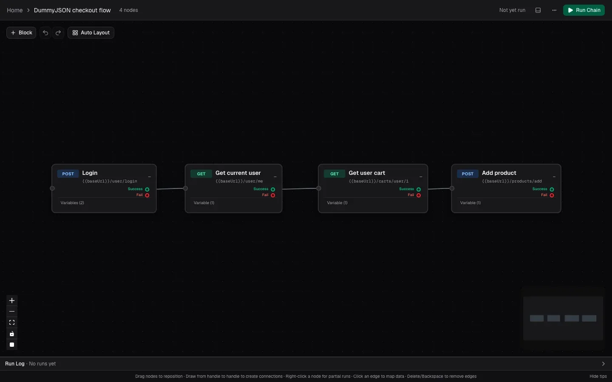
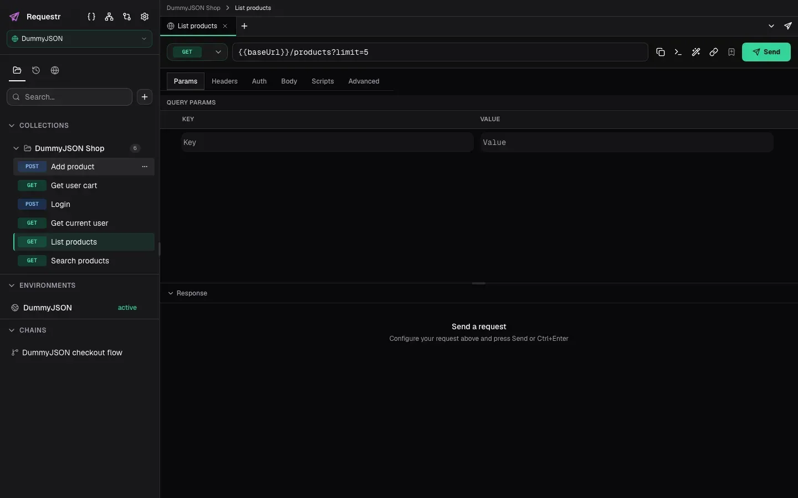
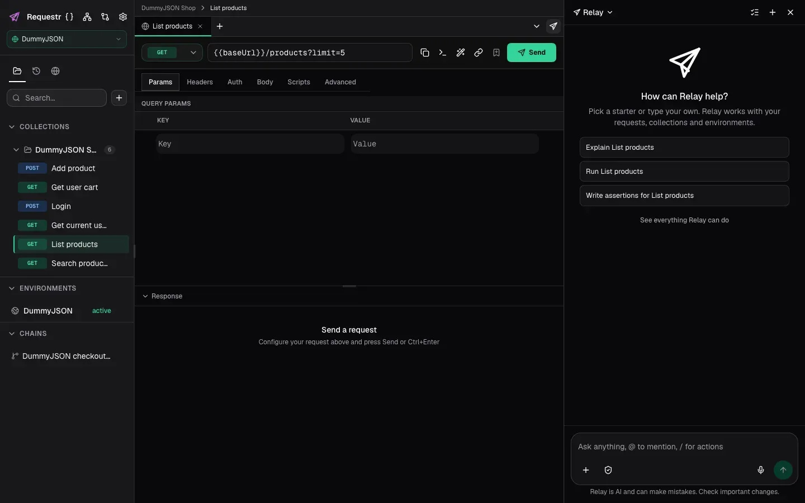
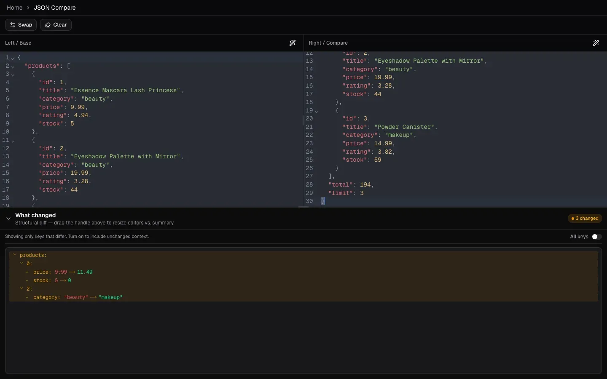
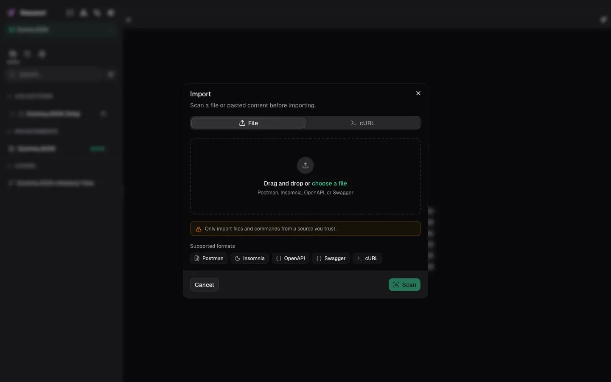

<div align="center">
  

  <h1>Requestr</h1>

  <p><strong>A browser-native API workbench.</strong><br/>No install, no account. Open a tab and start testing.</p>

  <p>
    <a href="https://requestr-api.vercel.app/"><strong>Open the live app →</strong></a>
  </p>

  <!-- demo:start -->
  
  <!-- demo:end -->

  <!-- badges:start -->


  <!-- badges:end -->
</div>

---

## Table of contents

- [Why Requestr](#why-requestr)
- [Features](#features)
- [Quick start](#quick-start)
- [Privacy & analytics](#privacy--analytics)
- [Tech stack](#tech-stack)
- [Contributing](#contributing)
- [License](#license)

## Why Requestr

Most API clients ask for a lot before they give you anything: a large desktop download, a sign-up, a cloud sync, then CORS walls the moment you test a real endpoint. Requestr removes that friction.

- **Open and go.** It's a URL. No installer, no login wall, no onboarding.
- **Your data stays yours.** Collections, environments, scripts and history are stored in your browser, not uploaded to us. A few features send data to a server or third party to work (the request proxy, AI, share links), and the privacy page lists each one.
- **No CORS dead-ends.** Requests are relayed through a server-side proxy, so browser security never blocks a legitimate call.
- **More than a request sender.** Visual chaining, assertions, an AI agent and JSON tooling are built in.

## Features

### HTTP, GraphQL and WebSocket

A full request builder with query params, headers, JSON/form/url-encoded bodies, and Bearer, Basic and API Key auth. Environments with `{{VARIABLE}}` interpolation, collections with drag-and-drop folders, searchable history, pre/post-request scripts, and a response viewer with pretty, raw, headers, preview and cookies. GraphQL gets schema introspection and query building, and WebSocket and Socket.IO sessions sit alongside regular requests.



### Visual request chains

Compose multi-step flows on a node canvas: pass values between requests, branch on conditions, loop over arrays, insert delays, and validate responses at each step. See [Chain blocks](docs/CHAIN_BLOCKS.md) for every block type and [Keyboard shortcuts](docs/SHORTCUTS.md) for the canvas bindings.


### Relay, the AI agent

Relay is an AI agent that works inside the workbench. Describe what you want in plain English and it can build requests, explain error responses, suggest assertions and headers, and help write scripts. Secrets are removed in your browser before anything is sent.



### Encrypted, accountless sharing

Share a request through a link whose payload is encrypted in your browser before it is stored. The key lives only in the URL fragment (`#...`), which is never sent to the server, so the backend holds ciphertext it cannot read. Links are rate limited and expire after 24 hours.

### Endpoint health monitoring

Track latency and success rates over time with p50 and p95 breakdowns, so a degrading endpoint stands out at a glance.

### Toolbox

- **JSON Compare** for a structural diff between two payloads
- **JSON Visualize** to render any JSON as an interactive graph
- **Transform Playground** to generate typed models from JSON
- **Code generation** for cURL, fetch, Axios, Go, Java, C#, Python and Ruby



### Import and export

Import from cURL, Postman v2.1, Insomnia, OpenAPI 3 and `.env` files. Export to Postman or any of the code targets above. Back up and restore your whole workspace from settings.



## Quick start

Use it online at [requestr-api.vercel.app](https://requestr-api.vercel.app/), or run it locally with [Bun](https://bun.sh):

```bash
bun install
bun run dev
```

Then open the URL printed in the terminal. The roadmap is in [ROADMAP.md](ROADMAP.md) and developer docs, including the [architecture overview](docs/ARCHITECTURE.md), are in [`docs/`](docs/README.md).

## Privacy & analytics

- Collections, requests, environments, history and settings stay in your browser. They are not uploaded to us.
- Anonymous usage events (an event name plus coarse values) are sent to help improve the app. They never contain request or response content, URLs or names, and the app sets no cookies for them.
- Your IP address is stripped before events are forwarded.
- You can opt out with the analytics toggle in settings, or with the browser's Do Not Track or Global Privacy Control signals.
- Feedback text and an email address are sent only if you enter them.
- Requests you send go through the proxy, which does not store them. Share links are encrypted in your browser and deleted after 24 hours.

The full details are on the in-app privacy page.

## Tech stack

Next.js, React 19, TypeScript, Tailwind CSS, Zustand with IndexedDB for local data, Biome, Vitest and Playwright, deployed on Vercel.

## Contributing

Contributions are welcome. Read [CONTRIBUTING.md](CONTRIBUTING.md) first, follow the [Code of Conduct](CODE_OF_CONDUCT.md), and report vulnerabilities as described in [SECURITY.md](SECURITY.md).

## License

Released under the [MIT License](LICENSE).
